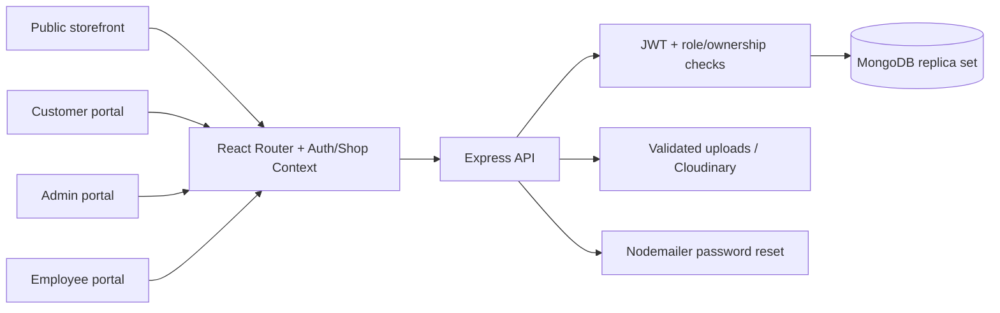
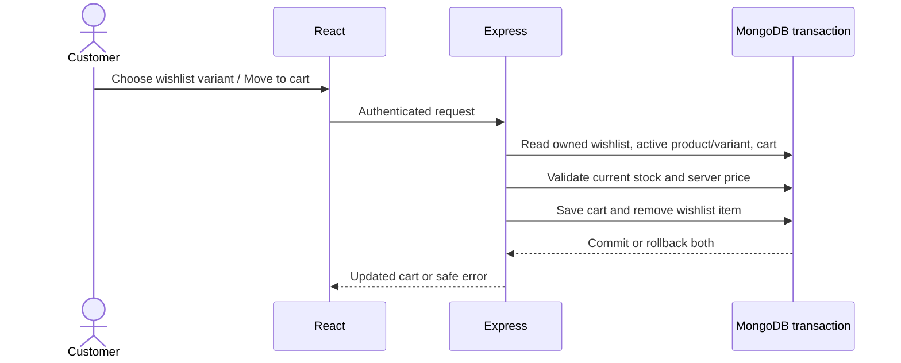
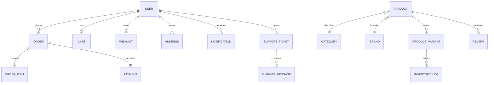

# Phase 2 — System and interface design

Companion: [Requirements baseline](phase1-requirements.md) and [wireframe sheet](phase2-wireframes.svg). Wireframes are design artifacts, not screenshots or evidence of a test run.

## Architecture

## Navigation and screen specifications
| Screen | Main regions | Main actions | Empty/error behavior |
|---|---|---|---|
| Catalog | Navigation, search/filter sidebar, sort/paging, cards | Filter by base price/colour/size/category/brand/availability; view product | No products message; request error and retry |
| Product detail | Image, price, variant selector, cart/wishlist, reviews | Select size/colour; add; review delivered purchase | Disable unavailable variants; surface validation |
| Wishlist | Saved product cards, variant selector | Move selected variant to cart; remove | Failed move retains saved item |
| Cart/checkout | Items, quantity, summary, address, coupon and COD | Update quantity; review current total; place order | Stock/coupon/address errors shown before commit |
| Customer account | Profile form/avatar; addresses; orders; notifications; support | Save profile/image; view order; create ticket/reply | Loading, validation and retry states |
| Admin/employee | Sidebar, KPIs, filters, tables and edit panels | Role-permitted management and operations | API rejects forbidden actions; tables can scroll |
| Information/contact | Page title, readable sections, working contact link | Contact shop or open own support ticket | No newsletter subscription is advertised |

Desktop uses side-by-side catalog regions. At small widths, filters precede product cards and navigation scrolls with the page. Forms fit the viewport and tables may scroll within their container.

## Transaction and ownership boundaries

Checkout commits order, items, payment, inventory log/alerts, coupon usage and cart clearing together. Stock transitions generate staff notifications within the same transaction. Profile image upload authenticates the current user, validates the file, saves the owned avatar and cleans replaced/staging assets.

## Database relationships

Actual schemas under backend/src/models are authoritative for field names, references, unique constraints and indexes. The built-in system-design, database-plan, page-flow and user-journeys pages remain available as design references.

## Deployment boundary
Development uses Vite API/upload proxies. Hosting, HTTPS and deployed CORS verification are Phase 11. No deployment or native Safari success is implied by this design.
